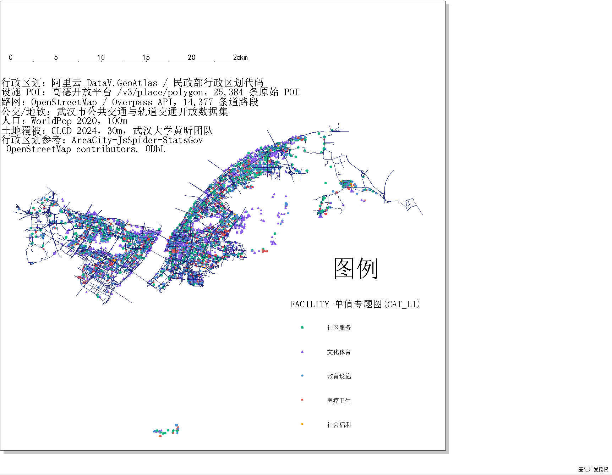

# 制图说明

> 适用任务：**T-015 符号库与地图文档**、**T-016 瓦片裁剪**
> 维护人：R2
> 版本：0.1.8（草稿，待审）
> 日期：2026-11-24
> 当前状态：T-015 地图文档主体已建立，符号 4.0×4.0、默认项已隐藏；`STREET` 已按 Polygon(3) 加入索引 2，但暂无街道数据；`mapdoc.png` 已有图例/比例尺/来源/水印，图例文案已中文，但顺序仍为 `COM→CUL→EDU→MED→WEL`，来源文字压图。T-016 未开始。
> 依据：`SPEC/01-requirements.md` FR-M3-01、`SPEC/02-data-model.md` §3.1/§5、`SPEC/03-api-contract.md` §11.2、`SPEC/07-tasks.md` T-015/T-016、`SPEC/00-overview.md` B-04/G-09

本文只记录**制图与瓦片**相关参数。T-014 的建库、字段映射和空间连接参数另见 `docs/建库记录.md`，不在此重复。

文中所有 `【待补】` 都是需要人工在 MapGIS Desktop 中确认或由后续任务回填的项；已确认的参数直接写死在表中，审阅时优先核对带 `【待补】` 的行。

---

## 0. 待补项总览

| # | 待补项 | 影响 | 处理建议 |
|---|---|---|---|
| 1 | `STREET` 已按 Polygon 加入索引 2，但仍无街道数据 | 暂不能做 `STREET_CODE` 空间连接 | 拿到街道面后导入该占位层 |
| 2 | 专题图分类顺序与文案 | 图例顺序可能不是 `SORT_NO` 顺序，文案不是 `L1_NAME` | 改为 `EDU → MED → CUL → WEL → COM`，文案改为中文 |
| 3 | 符号大小 4.0×4.0 | 初始视图下仍需目测确认是否可辨 | 在 Desktop 默认缩放下目测，必要时再调大并回填 |
| 4 | 全部图层可见时五类颜色被盖住 | `RESIDENTIAL` 未配符号，默认品红点压住 `FACILITY`；`DISTRICT` 面填充也会压盖 | 给 `RESIDENTIAL` 配小号灰色空心点或隐藏；`DISTRICT` 改无填充/高透明；不要移动 `FACILITY` 的索引 |
| 5 | 五个符号的形状/填充色 | 只能从 XML 确认符号 ID 不同，不能确认视觉形状 | 在 Desktop 符号属性面板逐一核对，截图留证 |
| 6 | `mapdoc.png` 图例顺序仍错，来源文字压图 | 不满足 FR-M3-01 图例顺序 | 把专题图五类顺序改为 `EDU→MED→CUL→WEL→COM` 后重新生成图例；来源文字移出地图范围 |
| 7 | `data/tiles/` 瓦片参数 | T-016 未开始 | 按第 6 节裁剪并回填实际参数 |
| 8 | 独立专题图 XML 的可见性 | 重新导入会把专题图退回隐藏 | 若继续使用，先把 `state` 改为 `VISIBLE`、五个 `isVisible` 改为 `1` |

---

## 1. 交付物与路径

| 交付物 | 路径 | 当前状态 |
|---|---|---|
| 地图文档 | `data/mapdoc/wh_facility.mapx` | 已建立，含 4 个业务图层 |
| GDB 数据源 | `data/gdb/wh_facility.hdf` | 已建立；本地数据源别名 `MapGisLocal/wh_facility` |
| 符号库 | `D:\tools\MapGis 10\Slib\gissymbol.sym` | 当前地图文档使用系统符号库 |
| 颜色库 | `D:\tools\MapGis 10\Slib\PColor_EXT.lib` | 已含五类要求的精确 RGB |
| 地图截图 | `docs/screenshots/mapdoc.png` | **已生成；图例文案已中文，顺序仍错，来源文字压图；需调整** |
| 底图瓦片 | `data/tiles/` | **待 T-016 生成**（当前仅 `.gitkeep`） |
| 前端符号配置 | `frontend/src/config/symbols.js` | 已定义五类颜色、形状、顺序 |
| 前端图例组件 | `frontend/src/components/MapLegend.vue` | 已按 `CATEGORY_ORDER` 渲染五类图例 |

> 地图文档只保存图层引用、符号和专题配置，**不嵌入 GDB 数据**。GDB 移动或改名后，地图文档中的 `GDBP://` 路径必须同步修改。

---

## 2. 地图文档

### 2.1 基本参数

| 参数 | 值 | 说明 |
|---|---|---|
| 地图文档文件 | `data/mapdoc/wh_facility.mapx` | 交付文件 |
| 内部地图名 | `wh_facility` | 必须与 `SYS_CONFIG.MAP_DOC_NAME` 一致 |
| MapGUID | `b5252cad-2281-46b6-992a-8c7be0098b34` | 地图文档内部标识 |
| 制作软件 | MapGIS Desktop 10.7.10.10 | 地图文档 `version` 属性 |
| 坐标系 | CGCS2000（EPSG:4490） | 地理坐标系，单位：度 |
| 坐标精度 | 十进制度，保留 6 位小数 | 不采用度分秒；与 `03` A-08 一致 |
| 数据源 | `data/gdb/wh_facility.hdf` | MapGIS 本地数据源 |
| 数据源别名 | `MapGisLocal/wh_facility` | `GDBP://` 路径前缀 |
| 是否嵌入数据 | 否 | 图层通过 `GDBP://` 引用 GDB |
| 初始视图范围 | 经度 `114.238555`–`114.459936`，纬度 `30.439416`–`30.591663` | XML 原值保留更多小数；这是初始视图，不是地图全范围 |
| 背景色 | 索引 9 | 以 Desktop 实际显示为准 |
| 当前图层数 | 5 | `FACILITY`/`DISTRICT`/`STREET`/`RESIDENTIAL`/`ROAD` |
| 底图 | 无 | 底图由 T-016 单独裁剪，不在本业务地图文档中 |

> 截图前建议执行一次“全图”，确保青山区、武昌区、汉阳区三区都在画面内；当前初始视图范围小于三区完整外包，直接截图可能裁掉边缘区域。

### 2.2 图层组织与索引

**目标顺序**（`03` §11.2 + `ROAD` 追加）：

| 索引 | 图层 | 几何类型 | 用途 |
|---:|---|---|---|
| 0 | `FACILITY` | Point | 五类设施点，专题图图层 |
| 1 | `DISTRICT` | Polygon | 行政区面 |
| 2 | `STREET` | Polygon | 街道面（占位） |
| 3 | `RESIDENTIAL` | Point | 居住小区点 |
| 4 | `ROAD` | Line | 路网线 |

**当前地图文档实际顺序**：

| 当前索引 | 图层 | 几何 | 状态 | 专题 | 记录数 | GDBP 路径 |
|---:|---|---|---|---|---:|---|
| 0 | `FACILITY` | Point | `ACTIVE` | `UniqueTheme(CAT_L1)` | 5534 | `GDBP://MapGisLocal/wh_facility/ds/FACILITY/sfcls/FACILITY` |
| 1 | `DISTRICT` | Polygon | `VISIBLE` | 无 | 3 | `GDBP://MapGisLocal/wh_facility/ds/DISTRICT/sfcls/DISTRICT` |
| 2 | `STREET` | **Polygon** | `VISIBLE` | 无 | 0（占位，待导入） | `GDBP://MapGisLocal/wh_facility/ds/STREET/sfcls/STREET` |
| 3 | `RESIDENTIAL` | Point | `VISIBLE` | 无 | 3041 | `GDBP://MapGisLocal/wh_facility/ds/RESIDENTIAL/sfcls/RESIDENTIAL` |
| 4 | `ROAD` | Line | `VISIBLE` | 无 | 14377 | `GDBP://MapGisLocal/wh_facility/ds/ROAD/sfcls/ROAD` |

当前索引已经对齐 `03` §11.2（`FACILITY=0`、`DISTRICT=1`、`STREET=2`、`RESIDENTIAL=3`），`ROAD` 追加为 4。`STREET` 的 `geometryType=3`（Polygon），URL 为 `ds/STREET/sfcls/STREET`，**占位类型满足要求**；当前没有街道数据，等数据到位后再导入。

> 图层索引以**地图文档中的顺序**为准，GDB 内要素类的排列顺序不作为发布索引。`ACTIVE` 只表示当前编辑层，不代表其他图层不可见。
>
> `03` §11.2 只定义了 `FACILITY=0`、`DISTRICT=1`、`STREET=2`、`RESIDENTIAL=3`；`ROAD` 未给固定索引，按追加顺序为 4。T-020 发布前必须按 A-11 复核图层索引与发布结果一致。

**显示顺序注意**：MapGIS 工作空间以**第一个图层为最底层**，目录树上越靠后的图层越显示在上层（官方文档：“后来居上”）。当前顺序 `FACILITY → DISTRICT → STREET → RESIDENTIAL → ROAD` 意味着 `FACILITY` 在最底层；`RESIDENTIAL` 又没有配置符号，MapGIS 会用默认品红点符号，正好盖住 `FACILITY` 的五类符号。这就是“全部图层可见时颜色相同”的原因，不是专题图配错了。处理办法见第 9 节 Q2。

### 2.3 新图层的保存位置

新增或修改图层时，统一保存在**同一个 GDB 数据源**：

- 数据源：`data/gdb/wh_facility.hdf`
- 别名：`MapGisLocal/wh_facility`
- 图层/要素类：`ds/<LAYER>/sfcls/<LAYER>`
- `STREET` 应保存为 `GDBP://MapGisLocal/wh_facility/ds/STREET/sfcls/STREET`

不要：

- 把新图层单独存成另一个 GDB；
- 把数据保存到 `data/mapdoc/` 或 `temp/`；
- 在 GDB 里改掉 `FACILITY`/`DISTRICT`/`STREET`/`RESIDENTIAL`/`ROAD` 的图层名。

`STREET` 占位图层至少应包含以下字段（最终以 `02` §3.1 和 GDB 实际字段为准）：

| 字段 | 含义 | 备注 |
|---|---|---|
| `STREET_CODE` | 街道代码 | `String(9)`，唯一；空值允许但 T-014 要求空值率 < 5% |
| `STREET_NAME` | 街道名称 | `String(50)` |
| `DIST_CODE` | 所属行政区代码 | `String(6)`，取值 `420107`/`420106`/`420105` |

> 当前 `data/` 下没有街道面源数据；地图文档里的 `STREET` 已经是 **Polygon 面层占位**，类型满足要求，但还没有要素。注意：**`STREET` 面本身不能由空间连接生成**；空间连接的作用是把已有街道面的 `STREET_CODE`/`STREET_NAME` 带到 `FACILITY`、`RESIDENTIAL` 点上。具体做法见第 9 节 Q4。

### 2.4 坐标系与投影

| 项目 | 规定 |
|---|---|
| 地图文档坐标系 | CGCS2000（EPSG:4490） |
| 坐标单位 | 度（十进制度） |
| 小数位 | 6 位 |
| 是否使用度分秒 | 否 |
| 是否在 MapGIS 内做动态投影 | 否；数据入库前已统一到 EPSG:4490 |
| `ROAD` 来源 | `data/road/study_area_edges.gpkg`，源 EPSG:32650，已由 GeoPandas 重投影到 EPSG:4490 |
| `FACILITY`/`DISTRICT`/`RESIDENTIAL` 来源 | EPSG:4326，导入时按目标 CGCS2000 入库 |

> WGS 84 与 CGCS2000 在厘米级一致，但项目对外统一表述为 **CGCS2000 / EPSG:4490**，接口经纬度保留 6 位小数（`03` A-08）。不要在文档或界面里写成 WGS 84 或度分秒。

---

## 3. 符号系统

### 3.1 五类设施符号总表

| 类别 | `L1_NAME` | `SORT_NO` 范围 | 颜色 HEX | RGB（0–255） | 形状 | MapGIS 符号 ID | 专题值 | 目标图例文案 |
|---|---|---|---:|---|---|---:|---|---|
| `EDU` | 教育设施 | 101–105 | `#4A90D9` | `74, 144, 217` | 圆形 circle | 212 | `EDU` | 教育设施 |
| `MED` | 医疗卫生 | 201–206 | `#E05252` | `224, 82, 82` | 方形 square | 213 | `MED` | 医疗卫生 |
| `CUL` | 文化体育 | 301–306 | `#8B5CF6` | `139, 92, 246` | 三角形 triangle | 214 | `CUL` | 文化体育 |
| `WEL` | 社会福利 | 401–405 | `#F59E0B` | `245, 158, 11` | 菱形 diamond | 215 | `WEL` | 社会福利 |
| `COM` | 社区服务 | 501–503 | `#10B981` | `16, 185, 129` | 五边形 pentagon | 216 | `COM` | 社区服务 |

说明：

- 颜色来源：`SPEC/02-data-model.md` §5 `DICT_CATEGORY.COLOR_HEX`，与 `frontend/src/config/symbols.js` 逐字一致。
- 形状来源：`frontend/src/config/symbols.js` 的 `shape` 字段；MapGIS 符号库中的 212–216 需目测确认与之一致。
- 图例顺序：按 `DICT_CATEGORY.SORT_NO` 升序，即 `EDU → MED → CUL → WEL → COM`，不得按字母序。
- 图例文案：必须等于 `L1_NAME`，不得用 `EDU`/`MED` 等英文代码。

### 3.2 符号库与颜色库

| 类型 | 路径 | 说明 |
|---|---|---|
| MapGIS 安装目录 | `D:\tools\MapGis 10` | Desktop 10.7.10.10 |
| 系统符号库 | `D:\tools\MapGis 10\Slib\gissymbol.sym` | 当前地图文档使用；五类符号 ID 212–216 |
| 颜色库 | `D:\tools\MapGis 10\Slib\PColor_EXT.lib` | 含五组与上表完全一致的 RGB |
| 项目内自定义符号库 | `data/mapdoc/【待补】.symbollib` | 若在 Desktop 中另存自定义库，必须回填实际路径 |

当前地图文档的 `SlibDir6x`、`ClibDir6x` 为空，`systemLibGUID` 为全零，表示**使用系统默认符号库/颜色库**，没有引用项目内独立符号库文件。若后续把符号另存为项目自定义库，必须把库文件放到 `data/mapdoc/` 并在上表登记，否则换机器后符号会丢失。若 Desktop 符号属性面板显示的库路径与上表不同，以面板实际路径为准并回填本节。

符号与颜色说明：

- 五类符号均为**矢量点符号**，通过 `pntInfo lib="0" id="212..216"` 引用符号库；不是 PNG/JPG 栅格图标。
- 颜色模式统一为 **RGB 0–255**，不使用 CMYK；地图文档内部保存调色板索引/内部颜色串，不直接保存 `#RRGGBB`，最终解析为 RGB。
- `PColor_EXT.lib` 中已存在五组与上表完全一致的 RGB；符号实际填充色以 Desktop 符号属性面板为准。
- 前端 `symbols.js` 用 HEX + 形状语义描述同一套符号，两边必须保持数值和形状语义一致。

### 3.3 专题图配置

| 配置项 | 当前值 | 目标值 | 状态 |
|---|---|---|---|
| 专题图名称 | `单值专题图(CAT_L1)` | 同左 | 通过 |
| 类型 | `UniqueTheme` | `UniqueTheme` | 通过 |
| 分类字段 | `CAT_L1` | `CAT_L1` | 通过 |
| 几何类型 | `geomInfoType=1`（点） | 点 | 通过 |
| 专题状态 | `VISIBLE` | `VISIBLE` | 通过 |
| 分类数 | 5 | 5 | 通过 |
| 分类值 | `COM`、`CUL`、`EDU`、`MED`、`WEL` | 同左 | 通过 |
| 分类项可见性 | 5 个 `isVisible=1` | 全部可见 | 通过 |
| 分类顺序 | `COM → CUL → EDU → MED → WEL` | `EDU → MED → CUL → WEL → COM` | **待调整** |
| 分类文案 | `COM`/`CUL`/`EDU`/`MED`/`WEL` | `社区服务`/`文化体育`/`教育设施`/`医疗卫生`/`社会福利` | **待调整** |
| 默认项 | `defaultInfo` 已隐藏（`isVisible=0`） | 保持隐藏 | 通过 |
| 符号大小 | `4.0 × 4.0` | 以初始视图可辨识为准 | **待目测** |
| 符号 ID | 212/213/214/215/216 | 同左 | 通过（形状待目测） |

> 分类顺序只影响图例/专题项顺序，不影响地图上点的落位；但 `FR-M3-01` 明确要求图例按 `SORT_NO` 升序，因此仍需调整。若 IGServer 或 Desktop 的图例读取 `uniqueInfo` 顺序，当前顺序会直接导致图例顺序错误。

当前专题图的五个 `pntInfo` 分别为：

| 专题值 | 符号 ID | 当前 `outclr` | 说明 |
|---|---:|---|---|
| `COM` | 216 | `949;4;3` | MapGIS 内部颜色串，最终颜色以符号属性面板为准 |
| `CUL` | 214 | `1428;4;3` | 同上 |
| `EDU` | 212 | `1167;4;3` | 同上 |
| `MED` | 213 | `126;4;3` | 同上 |
| `WEL` | 215 | `298;4;3` | 同上 |

### 3.4 图例规则

前端图例由 `MapLegend.vue` 按 `CATEGORY_ORDER` 渲染，当前配置已经满足：

1. 图例项数 = 5；
2. 顺序 = `EDU → MED → CUL → WEL → COM`；
3. 文案 = `CATEGORY_SYMBOLS[code].l1Name`；
4. 色块 = `CATEGORY_SYMBOLS[code].color`；
5. 图层隐藏时对应图例项置灰（FR-M1-05）。

地图文档侧的专题图图例（如果 Desktop/IGServer 使用 `uniqueInfo` 生成图例）必须同步改为中文 `L1_NAME` 和上述顺序，否则会出现“地图符号对、图例文案错”的不一致。

禁止：

- 图例出现第 6 类或数据字典之外的颜色；
- 只用颜色区分五类（形状必须不同）；
- 图例文案用英文代码代替 `L1_NAME`；
- 隐藏图层后图例仍保持高亮。

### 3.5 符号与图例核对表

在 Desktop 中打开 `wh_facility.mapx`，逐项勾选：

- [ ] 五类符号形状确实不同：圆、方、三角、菱形、五边形
- [ ] 五类填充色与 `#4A90D9`、`#E05252`、`#8B5CF6`、`#F59E0B`、`#10B981` 一致
- [ ] 符号大小在默认缩放下可辨识（当前 4.0×4.0）
- [ ] 专题图分类顺序为 `EDU → MED → CUL → WEL → COM`
- [ ] 图例文案为中文 `L1_NAME`
- [ ] 专题图状态为 `VISIBLE`，五类 `isVisible=1`
- [ ] 没有未知 `CAT_L1` 走默认符号；`defaultInfo` 已隐藏
- [ ] 全部图层可见时，`RESIDENTIAL`/`DISTRICT` 不会盖住五类设施符号
- [ ] 关闭/显示 `FACILITY` 图层时，专题图与图例同步变化

---

## 4. 地图文档制作步骤（复现）

1. 启动 MapGIS Desktop 10.7.10.10。
2. 打开本地数据源 `data/gdb/wh_facility.hdf`，确认 `FACILITY`、`DISTRICT`、`STREET`、`RESIDENTIAL`、`ROAD` 五个要素类存在。
3. 新建地图文档，内部地图名设为 `wh_facility`；**不要**沿用 `MapDoc` 之类的临时名称。
4. 设置地图坐标系为 CGCS2000（EPSG:4490），坐标显示为十进制度、6 位小数。
5. 按 `FACILITY → DISTRICT → STREET → RESIDENTIAL → ROAD` 的顺序添加图层；`STREET` 先加空占位层。
6. 右键 `FACILITY` → 专题图 → 单值专题图，分类字段选 `CAT_L1`，生成 5 个分类。
7. 为 5 个分类分别指定符号 ID 212–216，并核对颜色、形状、大小。
8. 把分类顺序调整为 `EDU → MED → CUL → WEL → COM`，文案改为对应 `L1_NAME`。
9. 确认专题图状态为可见，五个分类项全部可见，保存地图文档到 `data/mapdoc/wh_facility.mapx`。
10. 重新打开地图文档，按 3.5 核对表检查；截图按第 5 节执行。

> 如果只在 Desktop 里改了专题图但没有保存地图文档，`wh_facility.mapx` 不会更新；每次改完必须 `Ctrl+S` 并确认文件修改时间变化。

---

## 5. 截图规范（T-015）

### 5.1 截图要求

| 项目 | 要求 |
|---|---|
| 文件路径 | `docs/screenshots/mapdoc.png` |
| 格式 | PNG |
| 建议尺寸 | 1600×900 以上（1920×1080 更佳） |
| 必须包含 | 地图、五类设施符号、图例、比例尺、数据来源标注 |
| 符号要求 | 五类形状清晰可辨，不能只靠颜色区分 |
| 水印 | 保留 MapGIS 开发授权官方水印，不得裁掉（B-04） |
| 禁止 | 裁掉图例/来源标注；隐藏图层后截图；使用与数据不一致的颜色 |

截图步骤：

1. 打开 `wh_facility.mapx`，执行“全图”，确认三区都在画面内。
2. 确认 `FACILITY` 专题图可见，五类点都能看到；如果点太密，可放大到能同时看到五类的代表区域，并在图注中说明范围。
3. 打开图例面板，确认 5 项、顺序、中文文案正确。
4. 打开比例尺，确认单位公制。
5. 在画面角落保留数据来源标注（见 5.2）。
6. 截图保存为 `docs/screenshots/mapdoc.png`，不要按日期改名。

**当前 `mapdoc.png` 检查结果（2026-11-24 17:23，1724×1340）：**

| 检查项 | 结果 | 说明 |
|---|---|---|
| 文件路径/格式 | PASS | `docs/screenshots/mapdoc.png`，PNG |
| 分辨率 | PASS | 1724×1340，满足 ≥1500×900 |
| 地图内容 | PASS | 三区设施点、路网可见 |
| 五类颜色 | PASS | 五组精确 RGB 均存在 |
| 五类形状 | PASS | 圆/方/三角/五边形/菱形均能从图例辨认 |
| 图例存在性 | PASS | 版面右侧已有图例，5 项齐全 |
| 图例文案 | **PASS** | 已改为 `社区服务/文化体育/教育设施/医疗卫生/社会福利` |
| 图例顺序 | **FAIL** | 当前是 `COM → CUL → EDU → MED → WEL`，不是 `EDU → MED → CUL → WEL → COM` |
| 比例尺 | PASS | 顶部左侧完整显示 `0–25km` 比例尺条 |
| 数据来源 | PASS | 已含 7 类来源，并补了 `OpenStreetMap contributors, ODbL` |
| 水印 | PASS | 右下角可见“基础开发授权” |
| 版面质量 | 待优化 | 来源文字压到地图顶部；地图偏小、右侧和下方空白多；图例偏小 |

> 结论：**文件、格式、分辨率、地图、比例尺、来源、水印、图例文案都合格；只剩图例顺序不合格，另有来源文字压图、版面偏空的排版问题。** 当前图例顺序与专题图 `uniqueInfo` 的 XML 顺序一致（`COM → CUL → EDU → MED → WEL`）；在专题图属性里把五个分类调整为 `EDU → MED → CUL → WEL → COM` 后重新生成图例即可。

截图到位后，取消下面这行的注释即可在本文预览：

```markdown
<!--  -->
```

### 5.2 数据来源标注

截图/地图输出中的来源标注建议使用：

```text
数据来源：高德开放平台（POI，GCJ-02→WGS84）；DataV.GeoAtlas（行政区划）；
OpenStreetMap contributors（路网，ODbL）；天地图 / MapGIS（底图）。
```

合规要求：

- 底图只能用**天地图**或 **MapGIS 自制**；不得引入 Google / Apple / Bing 海外版 / OSM 直连瓦片 / Mapbox 底图（G-09）。
- OSM 只作为路网**矢量数据源**使用，不作为底图瓦片直接叠加；保留 ODbL 署名。
- 开发授权水印保留，不裁剪、不覆盖（B-04）。
- 截图和文档中不得出现真实天地图 Key；Key 由 `SYS_CONFIG.TIANDITU_TOKEN` / 环境变量注入，仓库中只保留 `__FILL_AT_DEPLOY__`。

### 5.3 比例尺的生成与固定

可以自动生成。MapGIS 10 Desktop 里有两套相关功能：

1. **地图视图的“显示比例尺”**：功能面板上方显示“当前窗口的比例尺”，随地图缩放实时变化；也可以直接输入比例尺，或从下拉框选择系统预设的 9 个比例尺，地图会自动缩放到该比例尺。它显示的是数字，不是图面上的比例尺条。
2. **版面的“比例尺/文本比例尺”**：在“排版与打印”中给版面添加图形比例尺或文本比例尺。数据有正确空间参照系时，系统自动计算；地图缩放时比例尺随之变化。文本比例尺的值与地图显示比例尺一致。

T-015 截图建议：

- 直接在版面里放地图框、图形比例尺、图例、数据来源文本，导出 PNG；这样比例尺是图面元素，不会只存在于软件状态栏。
- 如果要固定比例尺，先在地图视图的“显示比例尺”里输入目标值（如 `1:50000`），再切换到版面；或调整版面地图框的大小/范围，直到“版面显示比例尺”达到目标值。

注意事项：

- 比例尺由地图文档的空间参照系计算。本图是 EPSG:4490 地理坐标系，MapGIS 默认按 `1° = 111319.490793274 m` 换算，属于近似换算；地图文档里的 `ScaleOfSymbolSize=111319490.793274` 就是同一套换算。
- 比例尺会随窗口大小、屏幕 DPI 变化；同一地图文档在不同电脑上打开，数值可能不同。截图/打印以版面显示的比例尺为准。
- MapGIS 计算时按 96 dpi 估算 1mm；实际显示器 DPI 通常更高，用尺子量屏幕会有偏差，这是官方文档明确说明的正常现象。

---

## 6. 底图瓦片（T-016）

### 6.1 瓦片参数

| 参数 | 值 | 状态 |
|---|---|---|
| 输出目录 | `data/tiles/` | 待生成（当前仅 `.gitkeep`） |
| 层级 | `8–18` | 强制要求 |
| 裁图方式 | `天地图裁图方式` | 强制要求，便于与天地图叠加 |
| 底图来源 | 天地图 或 MapGIS 自制 | 强制要求（G-09） |
| 瓦片尺寸 | 【待补，通常 256×256】 | T-016 裁剪时回填 |
| 瓦片格式 | 【待补，PNG/JPG】 | 按底图类型选择 |
| 瓦片坐标系 | 【待补】 | 天地图标准通常为 EPSG:3857；实际以 IGServer 裁图参数为准 |
| 原点/分辨率 | 【待补】 | 与裁图方式绑定 |
| 目录/命名规则 | 【待补】 | 记录 `{z}/{x}/{y}` 或 MapGIS 实际结构 |
| 管理端预览地址 | 【待补】 | T-016 完成后填写 |
| 水印 | 保留官方水印 | B-04 |
| 是否含业务图层 | 否 | 底图与 `wh_facility` 业务图层分开，避免把设施点烘进瓦片 |

> `wh_facility.mapx` 当前不含底图图层。建议 T-016 单独准备底图地图文档/底图源进行裁剪，不要把 `FACILITY` 等业务图层一起裁进瓦片。

### 6.2 裁图步骤

1. 准备底图源：天地图在线服务或 MapGIS 自制底图；确认授权与水印要求。
2. 在 MapGIS Desktop 中新建底图地图文档，设置裁图方式为 `天地图裁图方式`。
3. 设置层级 `8–18`，输出目录 `data/tiles/`，按实际需要设置瓦片尺寸、格式、坐标系。
4. 执行裁剪，检查日志中的成功/失败瓦片数；失败数必须为 0。
5. 抽查每个层级：瓦片无缺失、无黑边、无接缝错位；注记不被瓦片边缘切断。
6. 在管理端“地图与数据服务”中预览瓦片服务，确认可正常加载。
7. 把实际参数（尺寸、格式、坐标系、原点、命名规则、预览地址）回填到 6.1 表。
8. 在前端把底图瓦片与 `wh_facility` 地图服务叠加，确认点位与底图配准。

### 6.3 合规与验收

- 瓦片层级必须覆盖 `8–18`，缺层视为不通过。
- 裁图方式必须是 `天地图裁图方式`，不得用普通 Web 墨卡托方案代替后不记录。
- 管理端必须能预览；不能只在本地文件系统看到瓦片。
- 底图来源只能是天地图或 MapGIS 自制；不得使用禁止的底图源。
- 瓦片与地图输出保留官方水印。

---

## 7. 验收检查表

### 7.1 T-015 DoD

| 验收项 | 判定方式 | 当前状态 |
|---|---|---|
| 地图文档可被 Desktop 打开 | 双击 `wh_facility.mapx`，无报错 | 已建立；待最终打开验收 |
| 五类符号各异（非仅颜色） | Desktop 目测 + 截图 | 符号 ID 各异；形状待目测 |
| 配色与字典一致 | 对照 `#4A90D9`/`#E05252`/`#8B5CF6`/`#F59E0B`/`#10B981` | 颜色库含精确 RGB；待符号属性确认 |
| 截图存 `docs/screenshots/mapdoc.png` | 文件存在且内容完整 | **文件存在；图例文案已中文，顺序仍错，来源文字压图** |
| 制图说明记录符号库路径 | 本文 3.2 节 | 已记录系统符号库路径 |

### 7.2 T-016 DoD

| 验收项 | 判定方式 | 当前状态 |
|---|---|---|
| 瓦片目录存在且层级 8–18 | 检查 `data/tiles/` 目录结构 | **未开始** |
| 管理端可预览瓦片 | 管理端“地图与数据服务”预览 | **未开始** |
| 裁图方式为 `天地图裁图方式` | 本文 6.1 + 裁图日志 | **待回填** |

### 7.3 FR-M3-01 / 图层契约

| 验收项 | 判定方式 | 当前状态 |
|---|---|---|
| 图例 5 项，文案 = `L1_NAME` | 前端图例 / Desktop 图例 | 前端已满足；地图文档文案待改 |
| 图例顺序按 `SORT_NO` | `EDU → MED → CUL → WEL → COM` | 前端已满足；地图文档顺序待改 |
| `FACILITY=0`、`DISTRICT=1`、`STREET=2`、`RESIDENTIAL=3` | 地图文档图层顺序 | **PASS**：索引已对齐，`STREET` 为 Polygon(3) |
| 图层索引与发布结果一致（A-11） | T-020 发布后核对 | 待发布 |

---

## 8. 已知问题与风险

| # | 问题 | 影响 | 处理 |
|---:|---|---|---|
| 1 | `STREET` 已按 Polygon 加入索引 2，但仍无要素 | 暂不能做 `STREET_CODE` 空间连接 | 拿到街道面后导入该占位层 |
| 2 | 专题图分类顺序为 `COM/CUL/EDU/MED/WEL` | 图例顺序不符合 `SORT_NO` | 调整为 `EDU/MED/CUL/WEL/COM` |
| 3 | 专题图文案为英文代码 | 图例文案不符合 `L1_NAME` | 改为中文名称 |
| 4 | 符号大小已改为 4.0×4.0，但仍未目测 | 初始视图可能仍偏小或过大 | Desktop 目测后回填最终值 |
| 5 | 五个符号形状/颜色未目测 | 无法证明“形状各异、颜色精确” | 逐一核对并截图 |
| 6 | `defaultInfo` 已隐藏 | 无未知值走默认符号 | 已处理，保持隐藏 |
| 7 | `mapdoc.png` 图例顺序仍错，来源文字压图 | 不满足 FR-M3-01 / 5.1 | 调整专题图顺序并重排版面 |
| 8 | `data/tiles/` 为空 | T-016 DoD 不通过 | 按第 6 节裁剪 |
| 9 | 独立专题图 XML 仍是 `UNVISIBLE` | 重新导入会把专题图退回隐藏 | 更新 `state`/`isVisible`，或归档不再使用 |
| 10 | 初始视图范围小于三区完整外包 | 截图可能裁掉边缘 | 截图前执行“全图” |
| 11 | `STREET` 无源数据，`STREET_CODE` 当前 100% 为空 | T-014 DoD 的 `< 5%` 未满足 | 补街道面后做空间连接；属 T-014 遗留，不阻塞 T-015 符号制作 |
| 12 | `ROAD` 索引未在 `03` §11.2 定义 | T-020 发布时可能与前端约定不一致 | 发布前与 R6 确认，保持 0–3 不变、`ROAD` 追加为 4 |
| 13 | 全部图层可见时五类颜色被 `RESIDENTIAL` 默认品红点覆盖 | 截图看起来“五类同色”，实际专题图是对的 | 给 `RESIDENTIAL` 配小号灰色空心点或临时隐藏；见第 9 节 Q2 |
| 14 | `DISTRICT` 面填充在 `FACILITY` 上方 | 会压暗/遮住设施点 | 改为无填充或高透明度，只保留边界 |

> `FACILITY` 当前 5534 条、`RESIDENTIAL` 当前 3041 条，略高于 `02` §3.1 的参考规模区间；T-014 DoD 只要求 `FACILITY ≥ 3000`，验收按 DoD 执行，规模差异在数据报告中说明即可。

---

## 9. 制图常见问题

### Q1 怎么更换五类设施的顺序？

先分清两种“顺序”。

**（1）专题图分类/图例顺序**（目标 `EDU → MED → CUL → WEL → COM`）

1. 右键 `FACILITY` →「专题图」→「专题图属性」。
2. 在分类列表中选中一项，尝试拖动或右键「上移/下移」（不同 10.x 小版本菜单名可能不同）。
3. 同时把每个分类的“名称”改为中文 `L1_NAME`。
4. 保存 `wh_facility.mapx`，重新打开确认顺序没有被还原。

当前 XML 的顺序是 `COM → CUL → EDU → MED → WEL`，正好是字母序；如果 Desktop 在保存/重开后仍按值自动排序，说明该版本单值专题图不支持自定义分类顺序。此时**不要改 `CAT_L1` 的值**来凑顺序。前端图例由 `CATEGORY_ORDER` 控制，已经正确；T-015 截图可以用手工图例或前端图例。最后手段才是备份后编辑 `<uniqueInfos>` 顺序再导入，而且 MapGIS 保存时可能再次排序。

**（2）图层显示顺序**

工作空间里拖动图层即可；官方规则是“第一个图层在最底层，越靠后的图层越在上层”。但**不要为了把 `FACILITY` 拖到顶层而改变它的索引 0**，否则 `03` §11.2 的 `LAYER_FACILITY=wh_facility/0` 和前端取层都会失效。正确做法是给上层图层配透明/低调符号，见 Q2。

### Q2 全部图层可见时五类颜色相同怎么办？

不是五类符号配错了，而是 `RESIDENTIAL` 的默认品红点盖住了 `FACILITY`。

判断依据：

- `部分图层不可见.png` 里五色正常；`全部图层可见.png` 里品红 `(255,0,255)` 约 6.2 万像素，五色各只有几百像素。
- `RESIDENTIAL` 图层在 `wh_facility.mapx` 中没有配置 `geoInfo`/符号，MapGIS 使用默认点符号。
- 当前 XML 顺序 `FACILITY → DISTRICT → RESIDENTIAL → ROAD`，按“后来居上”，`RESIDENTIAL` 显示在 `FACILITY` 上方。

处理（保持索引 0–3 不变）：

1. 右键 `RESIDENTIAL` →「属性」或「专题图」→ 统一专题图，选一个小号灰色空心圆（如 2.0）；只在 T-015 截图时也可以临时隐藏 `RESIDENTIAL`。
2. 右键 `DISTRICT` →「属性」→ 填充设为**无填充/高透明**，只保留边界，避免压暗设施点。
3. `ROAD` 设为细灰线，避免抢视觉。
4. 保存地图文档，在“全部图层可见”状态下重截，确认五色都能看到。

不要：把 `FACILITY` 拖到最顶层（索引会变）；把五类改成同一颜色；用白色面去盖 `RESIDENTIAL`。

### Q3 `.hdf` 要转成 `.gdb` 吗？`.hdf` 合乎要求吗？

- `data/gdb/wh_facility.hdf` 是 **MapGIS 10 HDF 文件型地理数据库**（`MapGISLocal` 数据源），就是本项目要求的 MapGIS GDB。`02` §3.1、T-014 只要求“MapGIS GDB”，没有要求扩展名是 `.gdb`。
- MapGIS 10 文档里的 `.gdb` 是 **ArcGIS File Geodatabase** 的导入/导出格式，不是 MapGIS 原生 GDB。转成 `.gdb` 会变成 Esri 格式，且 `GDBP://MapGisLocal/wh_facility/...` 路径要重做，不建议。
- 正确做法：保留 `.hdf` 作为主库；验收时在 MapGIS GDBCatalog 的 `MapGISLocal/wh_facility` 节点展示五个图层即可。
- 如果确实需要交换副本，可在 MapGIS 中导出 ArcGIS File GDB 作为副本，但不要替换主库。`.hdb` 是 MapGIS 新版文件库，也不是必须。

### Q4 STREET 数据怎么来？空间连接怎么做？

先纠正一个概念：**`STREET` 是街道面边界，不是空间连接生成的结果**。空间连接生成的是 `FACILITY.STREET_CODE`、`FACILITY.STREET` 和 `RESIDENTIAL.STREET_CODE`。

当前 `wh_facility.mapx` 里的 `STREET` 已经是 **Polygon(3) 面层占位**，类型满足要求，但还没有要素；拿到街道面后直接导入这个占位层，再做“点在内”的空间连接。

**第 1 步：先拿到街道面**

来源优先级建议：

1. 区民政/自然资源部门公开的街道级行政区划边界（最权威）。
2. 天地图/MapGIS 行政区划服务导出的街道面。
3. OSM `boundary=administrative` 的街道级关系（先检查三区覆盖是否完整，保留 ODbL 署名）。
4. 其他带官方代码的行政区划数据。

当前 DataV.GeoAtlas 的 `420107` 只有区级边界（`420107_full.json` 当前返回 404，`420107.json` 只有 1 个 district），不能直接当街道面。

街道面至少要有：

| 字段 | 要求 |
|---|---|
| `STREET_CODE` | `String(9)`，唯一，建议用官方 9 位代码 |
| `STREET_NAME` | `String(50)` |
| `DIST_CODE` | `String(6)`，`420107`/`420106`/`420105` |

导入 GDB 的 `STREET` 图层，CRS 统一 EPSG:4490。同时把街道记录灌入 MySQL `DICT_STREET`，否则 `DI-04` 和街道统计会失败。

**第 2 步：空间连接**

1. 在 MapGIS Desktop 中同时加载 `FACILITY` 和 `STREET`。
2. 菜单「分析」→「空间连接」。
3. 目标要素：`FACILITY`；连接要素：`STREET`；输出：新层 `FACILITY_JOINED`（先备份，不要直接覆盖原层）。
4. 连接操作：**一对一**；勾选**保留所有目标要素**。
5. 字段映射：`STREET_CODE` ← `STREET.STREET_CODE`；`STREET` ← `STREET.STREET_NAME`；不要把源 `FID` 映射到目标 `FID`。
6. 匹配选项：**在内**（点落在街道面内）；边界点可用**相交**；容差 `0.0001`（度）或按数据调整。
7. 执行后核对：输出记录数 = 5534；`STREET_CODE` 空值率 < 5%；所有非空值都能在 `DICT_STREET` 中找到。
8. 把结果写回 `FACILITY`（追加/更新），重建 `STREET_CODE` 索引。
9. 对 `RESIDENTIAL` 重复一次，目标 `RESIDENTIAL`，只映射 `STREET_CODE`。
10. 把源图层、目标图层、匹配关系、容差、输出记录数写进 `docs/建库记录.md`。

**如果拿不到街道面**

不要用设施点做 Thiessen/Voronoi 面冒充官方街道边界；可以做近似面，但必须标注“近似”，不能用于 T-014 的 `STREET_CODE` DoD。可先完成区级 `DISTRICT_CODE` 连接，`STREET_CODE` 保留空值并在建库记录中说明缺口；这会影响 T-014 DoD，需尽早向负责人报风险。

### Q5 版面里出现两个相同地图怎么办？

一个版面允许有多个“幅面”（数据框），每个幅面都可以挂一幅地图；出现两个相同地图，通常是**两个幅面都挂了同一幅 `wh_facility`**，不是软件自动复制的 bug。常见触发方式：

- 先用了“一键成图”生成一幅新地图，又在版面里“添加地图”一次；
- 进入版面时自动建了一个幅面，随后又新建/复制了一个幅面；
- 复制粘贴了幅面。

处理：

1. 先保存 `wh_facility.mapx`，再动版面。
2. 在版面里分别点击两个地图：如果两个都能单独选中、单独拖动，就是两个独立幅面。看版面/工作空间树里是否出现两个“地图”或“幅面”节点。
3. 选中多余的那个幅面，右键 →「删除」。如果菜单里有「移除幅面」优先用「移除」，不要用会连带删除地图的「删除地图」。
4. 如果弹出“会同时删除目录空间中的地图”的提示，先取消；改用非破坏方式：双击多余幅面 →「幅面设置」→ 把 X/Y 移到版面外（如 X=-500mm），或把宽高改到很小。这样输出时版面外内容不会被打印；但最后不要用“自动检测幅面”，否则版面会被撑大。
5. 两个幅面完全重叠、选不到下面那个时：先选中上面的，右键「叠放次序」→「下移一层」/「置于底层」，或先把上面的拖开，再选下面那个。
6. 如果版面里还没有比例尺、图例等成果，最省事的是：关掉版面不保存，重新“打开版面”，只添加一次地图，再按 5.3 加比例尺、图例、来源。

> 不要用两个幅面分别显示同一幅地图的同一范围来“凑”版面；T-015 只需要一个地图幅面。

---

## 10. 变更记录

| 版本 | 日期 | 修改内容 | 作者 |
|---|---|---|---|
| 0.1.0 | 2026-11-24 | 初稿：记录地图文档、五类符号、图例规则、截图要求、瓦片占位参数与待补项 | R2 |
| 0.1.1 | 2026-11-24 | 补充：显示顺序与 `RESIDENTIAL` 默认符号覆盖、4.0 符号、截图草稿状态、`.hdf`/`.gdb` 说明、STREET 空间连接流程 | R2 |
| 0.1.2 | 2026-11-24 | 补充 5.3：地图显示比例尺、版面比例尺的自动生成与固定方法 | R2 |
| 0.1.3 | 2026-11-24 | 补充 Q5：版面中出现两个相同地图的排查与删除/隐藏方法 | R2 |
| 0.1.4 | 2026-11-24 | 同步当前 mapdoc：`STREET` 已加入索引 2，但为线层，需改 Polygon 面层 | R2 |
| 0.1.5 | 2026-11-24 | 增加 `mapdoc.png` 检查结果：缺图例、比例尺被裁、符号黑底，需重出 | R2 |
| 0.1.6 | 2026-11-24 | 复查新版 `mapdoc.png`：图例/比例尺/来源/水印已补齐；图例顺序与文案仍错，来源文字压图 | R2 |
| 0.1.7 | 2026-11-24 | 复核 `STREET`：已为 Polygon(3)、索引 2、`ds/STREET` 路径，占位类型满足；暂无要素 | R2 |
| 0.1.8 | 2026-11-24 | 复查 `mapdoc.png`：图例文案已中文；顺序仍为 COM→CUL→EDU→MED→WEL，来源文字仍压图 | R2 |

---

## 附录 A：路径速查

| 用途 | 路径 |
|---|---|
| 地图文档 | `data/mapdoc/wh_facility.mapx` |
| GDB 数据源 | `data/gdb/wh_facility.hdf` |
| 地图截图 | `docs/screenshots/mapdoc.png` |
| 底图瓦片 | `data/tiles/` |
| 系统符号库 | `D:\tools\MapGis 10\Slib\gissymbol.sym` |
| 颜色库 | `D:\tools\MapGis 10\Slib\PColor_EXT.lib` |
| 前端符号配置 | `frontend/src/config/symbols.js` |
| 前端图例组件 | `frontend/src/components/MapLegend.vue` |
| 独立专题图 XML（中间文件） | `D:\learnabout\GIS\专题图（catL_1).xml` |

## 附录 B：相关条款

| 条款 | 内容 |
|---|---|
| `FR-M3-01` | 五类设施使用 `symbols.js` 的颜色与图标；颜色与 `DICT_CATEGORY.COLOR_HEX` 一致；形状互不相同；图例 5 项、按 `SORT_NO` 升序、文案 = `L1_NAME` |
| `02` §5 | `DICT_CATEGORY` 种子颜色：EDU `#4A90D9`、MED `#E05252`、CUL `#8B5CF6`、WEL `#F59E0B`、COM `#10B981` |
| `03` §11.2 | `LAYER_FACILITY=wh_facility/0`、`LAYER_DISTRICT=1`、`LAYER_STREET=2`、`LAYER_RESIDENTIAL=3` |
| `03` A-11 | 图层索引必须与发布结果一致，变更必须同步配置并通知全组 |
| `03` A-08 | 经纬度统一 CGCS2000（EPSG:4490），6 位小数 |
| `T-015` | 地图文档可打开、五类符号各异、截图 `docs/screenshots/mapdoc.png`、制图说明记录符号库路径 |
| `T-016` | 瓦片目录、层级 8–18、管理端可预览、裁图方式 `天地图裁图方式` |
| `G-09` | 底图只用天地图或 MapGIS 自制，禁止海外底图/OSM 直连瓦片/Mapbox |
| `B-04` | 开发授权水印保留，地图显示/制图输出/瓦片裁剪均带官方水印 |
